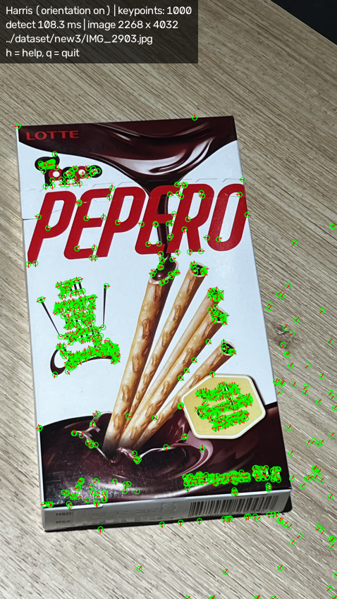
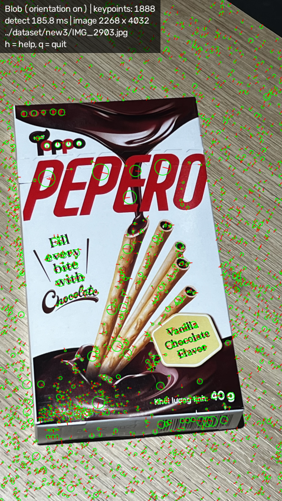
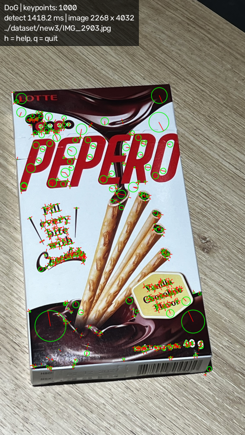
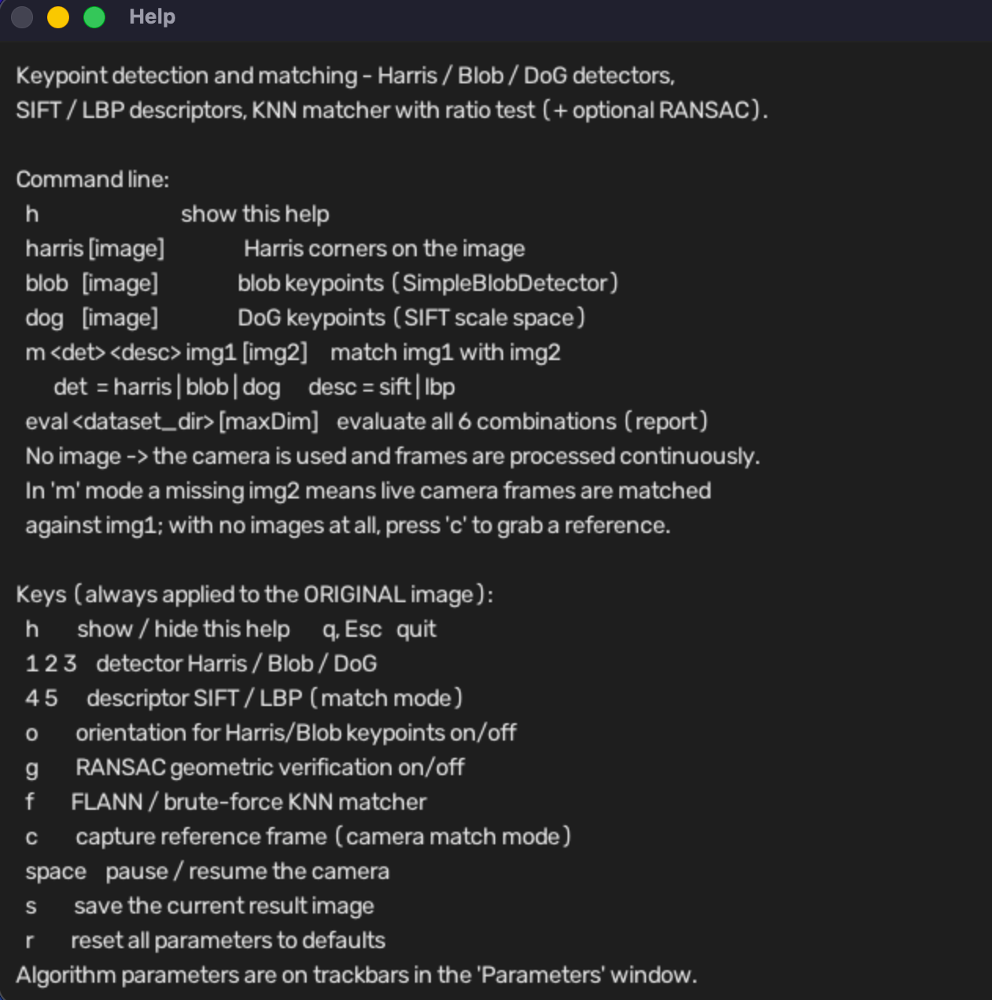
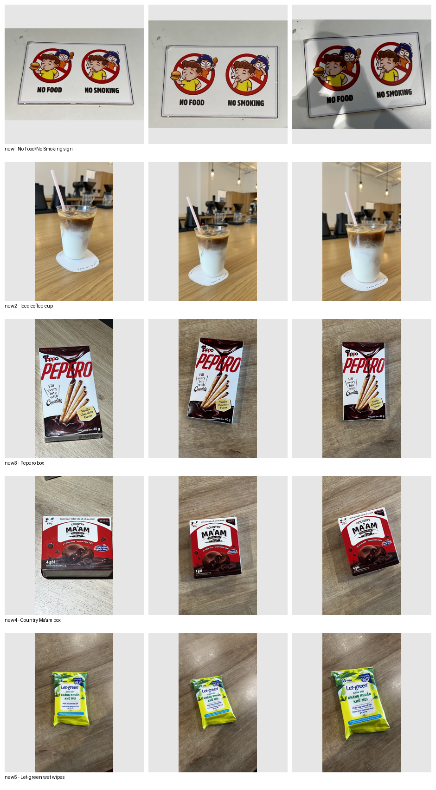
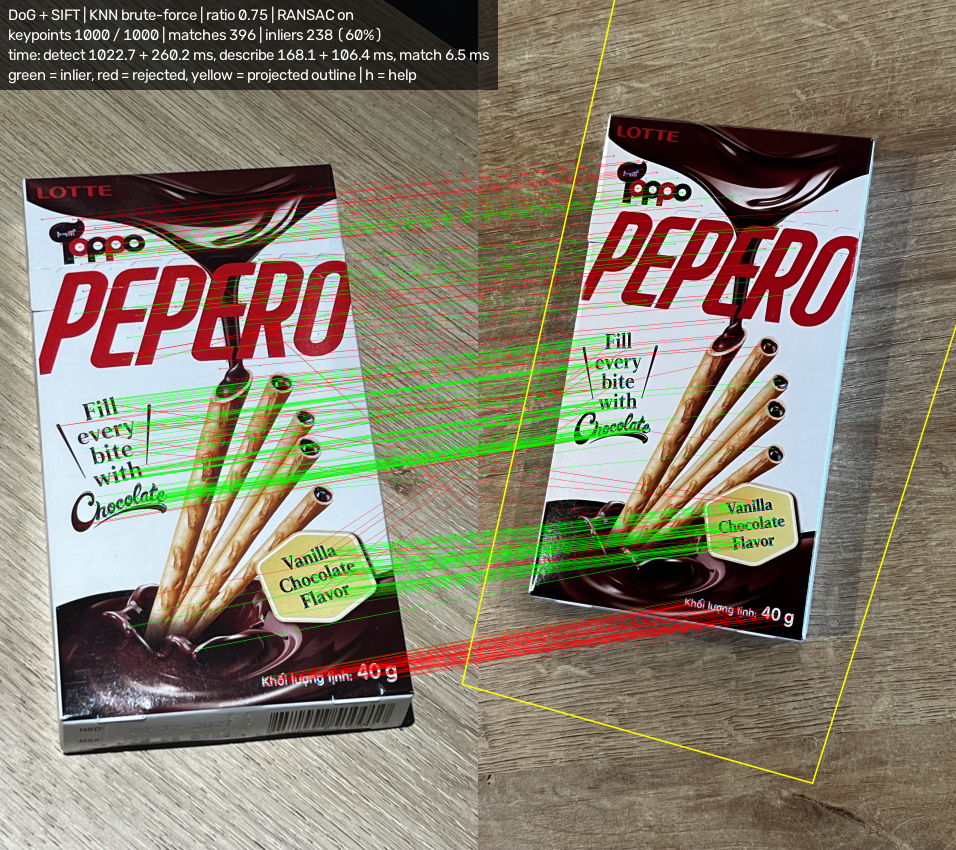
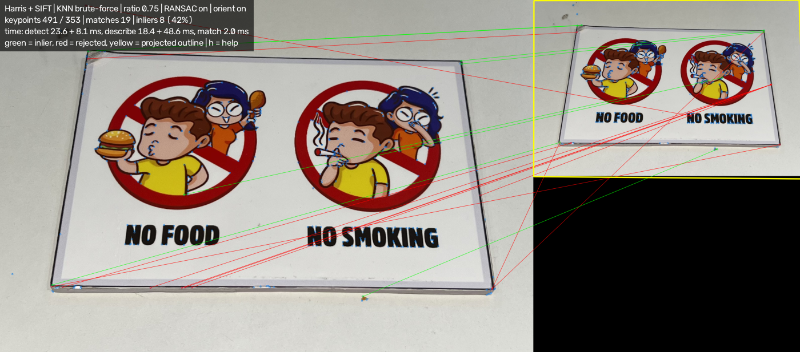

# Keypoint Detection and Matching – Report

Student: Châu Hữu Phát  ID: 19125063

## 1. Program overview

`FeatureMatcher` implements command-line options (a)–(j) from the assignment, plus
an `eval` mode used to produce the tables below:

```
FeatureMatcher h
FeatureMatcher harris|blob|dog [image]
FeatureMatcher m <harris|blob|dog> <sift|lbp> [image1] [image2]
FeatureMatcher eval <dataset_dir> [maxDim]
```

Images are read with `IMREAD_COLOR` (always 3 channels) and processed at full
resolution regardless of input size (large images are only down-scaled for on-screen
display, never for the actual detection/description/matching). Without a file argument
the program opens the default camera and processes frames continuously. Every
operation (detector, descriptor, matcher parameter) is always applied to the
**original** image/frame, never to the result of a previous processing step.

Algorithm parameters are exposed as trackbars in a separate "Parameters" window
(block size, thresholds, areas, octave layers, ratio-test threshold, RANSAC
threshold, …), and keys switch detector/descriptor and toggle options at run time
(`h` lists all of them; see the Keys list reproduced in the program's own `h` help
screen).

Harris keypoints on a static image (`harris` command):


Blob keypoints on a static image (`blob` command):


DoG keypoints on a static image (`dog` command):


The `h` help window, listing every command and key:


## 2. Algorithms

### 2.1 Harris corner detector
For each pixel the structure tensor M = Σ w(x,y) [Ix² IxIy; IxIy Iy²] is built over a
`blockSize` window from Sobel derivatives (`aperture` 3/5/7). The corner response is
R = det(M) − k·trace(M)². Pixels with R > t·max(R) that are the maximum of a
(2r+1)×(2r+1) neighbourhood (non-maximum suppression) are corners; the strongest
`maxPoints` are kept. Harris has no scale, so each corner gets a fixed support size
(`KP size`) for description.
Trackbars: block size, aperture, k, threshold, NMS radius, max points, KP size.

### 2.2 Blob detector (SimpleBlobDetector)
The image is thresholded from `minThreshold` to `maxThreshold` in steps of
`thresholdStep`. Connected components are found in each binary image; their
centres are grouped across thresholds and kept if they appear in at least two
levels. Blobs are filtered by area, circularity 4πA/P², convexity A/A_hull and
inertia ratio (elongation). Keypoint size = blob diameter.
Trackbars: thresholds, step, min/max area, circularity, convexity, inertia, min distance, colour.

### 2.3 DoG detector
A Gaussian scale space is built (octaves × `nOctaveLayers`, base `sigma`) and
adjacent levels are subtracted (DoG ≈ scale-normalised Laplacian of Gaussian).
Extrema in the 3×3×3 neighbourhood are refined to sub-pixel/sub-scale accuracy;
low-contrast points (`contrastThreshold`) and edge responses (principal-curvature
ratio > `edgeThreshold`) are rejected. Each keypoint receives a dominant
orientation from a gradient-orientation histogram.

### 2.4 Orientation for Harris and Blob keypoints
A 36-bin histogram of gradient directions in a Gaussian-weighted disc around the
keypoint (weighted by gradient magnitude) is smoothed and its peak interpolated.
This gives Harris/Blob keypoints an orientation so that both descriptors become
rotation invariant (key `o` turns it off for comparison).

### 2.5 SIFT descriptor
The region around the keypoint is rotated to the keypoint orientation and scaled to
its size, divided into 4×4 cells, and an 8-bin gradient-orientation histogram is
built per cell (Gaussian weighting, trilinear interpolation) -> 128-D vector,
normalised, clipped at 0.2 and renormalised.

### 2.6 LBP descriptor (own implementation)
1. A 34×34 patch is sampled around the keypoint, rotated by its orientation and
   covering `region × keypoint size` pixels; sampling uses the Gaussian-pyramid level
   that matches the scale to avoid aliasing.
2. For each inner pixel an 8-bit LBP code is computed: neighbour >= centre -> 1.
3. Codes are mapped to 59 bins (58 uniform patterns + 1 non-uniform bin).
4. The 32×32 code map is split into a 4×4 grid -> 16 histograms -> 944-D vector.
5. Each cell is L1-normalised and square-rooted (Hellinger kernel), then the whole
   vector is L2-normalised so Euclidean distance can be used for matching.

### 2.7 Matching
KNN matcher (k = 2, brute-force L2 or FLANN). Lowe's ratio test keeps a match if
d1 < ratio · d2. RANSAC then estimates a homography (reprojection threshold in px)
and separates inliers (green) from outliers (red); the projected outline of image 1
is drawn in yellow.

### 2.8 Implementation note – OpenCV functions vs. self-implemented code
All three keypoint **detectors** call OpenCV directly: Harris uses `cv::cornerHarris`
(our own code only does the thresholding/NMS/keypoint packaging on top of the
returned response map), Blob uses `cv::SimpleBlobDetector`, and DoG uses
`cv::SIFT::detect`. The **SIFT descriptor** likewise calls `cv::SIFT::compute`.
The only algorithm implemented entirely from scratch is the **LBP descriptor**
(`computeLBPDescriptors` in `features.cpp`), since OpenCV has no keypoint-based LBP
descriptor. Because the program is built on OpenCV's own detector/descriptor
implementations rather than re-deriving them from scratch, it is not restricted to
options (a), (b), (d), (f), (j) and implements the full (a)–(j) matrix, including all
six detector/descriptor combinations.

## 3. Evaluation

### 3.1 Dataset
Five everyday objects were photographed on an iPhone (3 photos each, different
viewpoint/distance/background for every shot) and converted from HEIC to JPG before
running the evaluation:

| Folder | Object |
|---|---|
| `dataset/new`  | Laminated "No Food / No Smoking" sign (flat, printed graphics + text) |
| `dataset/new2` | Iced coffee in a clear plastic cup with a straw, café table background |
| `dataset/new3` | Lotte "Toppo Pepero" chocolate-filled biscuit-stick box |
| `dataset/new4` | "Country Ma'am" chocolate-chip cookie box |
| `dataset/new5` | "Let-green" antibacterial wet-wipes pack |

The set mixes flat, highly textured packaging (new, new3, new4, new5 — lots of
printed text/logos, good for keypoint detectors) with a glossy, largely untextured
transparent cup (new2 — few stable corners/blobs, a harder case).



### 3.2 Protocol
`FeatureMatcher eval dataset 1000` with default parameters (max image side 1000 px).
- **A. Object matching**: all 105 ordered image pairs (15 images × 14, excluding
  self-pairs counted once per unordered pair) are matched; score = RANSAC inliers.
  Metrics: mean inliers for same-object and different-object pairs, top-1 retrieval
  accuracy (is the best-matching other image of the same object?), AUC (probability
  a same-object pair scores higher than a different-object pair), average keypoints
  and run times.
- **B. Robustness**: each image is rotated 30°/90°, scaled 0.5×, perspective-warped,
  blurred (σ = 2.5) and darkened (×0.4) with a known homography H. A match is
  correct if H maps it within 3 px. Metrics: correct matches/image and precision.

### 3.3 Results

**Table A** — object matching (`Document/eval_results/eval_summary.csv`):

| Combination | kp/img | det ms | desc ms | match ms | inliers same | inliers diff | top-1 | AUC |
|---|---|---|---|---|---|---|---|---|
| Harris+SIFT | 326 | 5.3 | 10.0 | 0.2 | 98.7 | 0.0 | 100% | 1.000 |
| Harris+LBP  | 326 | 5.6 | 3.1  | 1.0 | 11.7 | 0.0 | 87%  | 0.800 |
| Blob+SIFT   | 152 | 15.1| 9.6  | 0.1 | 29.7 | 0.0 | 100% | 1.000 |
| Blob+LBP    | 152 | 15.3| 1.3  | 0.3 | 11.2 | 0.0 | 100% | 0.933 |
| DoG+SIFT    | 898 | 17.3| 13.1 | 4.0 | 283.9| 7.1 | 100% | 0.995 |
| DoG+LBP     | 898 | 17.4| 7.5  | 7.9 | 116.4| 0.0 | 100% | 1.000 |

**Table B** — robustness, correct matches/image (precision %) (`Document/eval_results/eval_synthetic.csv`):

| Combination | rot30 | rot90 | scale0.5 | persp | blur | dark |
|---|---|---|---|---|---|---|
| Harris+SIFT | 210 (86%) | 317 (99%) | 2 (35%)  | 138 (80%) | 36 (50%) | 312 (98%) |
| Harris+LBP  | 138 (98%) | 318 (100%)| 0 (100%) | 56 (98%)  | 2 (97%)  | 262 (100%)|
| Blob+SIFT   | 68 (86%)  | 140 (98%) | 17 (76%) | 55 (84%)  | 14 (64%) | 52 (85%)  |
| Blob+LBP    | 52 (98%)  | 137 (100%)| 10 (96%) | 37 (96%)  | 4 (78%)  | 42 (97%)  |
| DoG+SIFT    | 508 (94%) | 806 (99%) | 231 (87%)| 475 (92%) | 128 (84%)| 628 (97%) |
| DoG+LBP     | 381 (98%) | 703 (99%) | 92 (97%) | 336 (97%) | 35 (95%) | 521 (100%)|

A strong same-object match: `m dog sift` on two `new3` Pepero-box photos — 1000/1000
keypoints, 396 ratio-test matches, 238 RANSAC inliers (60%), clean yellow projected
outline:


A failure case: `m harris sift` on a `new` photo vs. its own image scaled to 50%
(same transformation as the `scale0.5` robustness test) — only 491/353 keypoints
survive the resize, 19 ratio-test matches and just 8 RANSAC inliers (42%), visibly
illustrating Harris's lack of scale invariance (Table B, 35% precision for
Harris+SIFT under `scale0.5`):


Optional: repeat with orientation off (`o`) or different ratio values to show the
effect of a parameter.

## 4. Discussion – strengths and weaknesses

**Object-matching accuracy (Table A).** Every combination except Harris+LBP reaches
100% top-1 retrieval and an AUC >= 0.93 on this 5-object dataset, because the objects
are visually very different (packaging text/logos vs. a plain cup) and the photos
were taken from similar distances/angles, so the "different object" pairs score ~0
inliers while "same object" pairs score tens to hundreds of inliers. Harris+LBP is
the only combination that makes mistakes (87% top-1, AUC 0.80): LBP is a coarse,
low-dimensional (944-D over 59-bin histograms) texture descriptor, and Harris corners
carry no inherent scale — together they are less discriminative than SIFT when two
images of different objects happen to share similar small-scale texture patterns
(e.g. two cardboard-box surfaces). DoG+SIFT finds far more keypoints (898/img) than
Blob (152/img), because DoG responds to any strong-contrast blob/edge across many
scales, while SimpleBlobDetector only keeps components that survive multiple
threshold levels and the shape filters.

**Robustness (Table B).**
- *Rotation*: all combinations survive 90° rotation well (>=98%), since none of the
  descriptors are rotation-sensitive once an orientation is assigned (key `o`). 30°
  rotation is harder for SIFT-based combinations (Harris+SIFT 86%, DoG+SIFT 94%)
  than for LBP-based ones (98%+), suggesting our dominant-orientation estimate is
  slightly less precise for Harris/SIFT than the built-in SIFT orientation used by
  DoG.
- *Scale 0.5×* is the weakest case for Harris (35% precision, essentially unusable)
  and still weak for Blob (76%), because neither detector is scale-invariant — a
  corner/blob detected at full resolution often is not detected again (or not at the
  same support size) after the image is shrunk. DoG, being a genuine multi-scale
  detector, degrades far less (87–97%).
- *Blur* is the hardest transformation for every combination (50–95% precision):
  heavy Gaussian blur (σ = 2.5) removes the high-frequency corner/edge/texture
  information all three detectors and both descriptors rely on. LBP-based
  combinations cope noticeably better than their SIFT counterparts here (e.g.
  Harris+LBP 97% vs Harris+SIFT 50%), likely because LBP only needs local
  sign-of-difference comparisons rather than precise gradient orientation
  histograms, which blur destroys first.
- *Perspective warp and darkening* are handled well by all combinations (>=80%, mostly
  >90%), since a moderate perspective warp changes local appearance only slightly and
  multiplicative darkening does not affect gradient direction or relative pixel
  ordering (both of which SIFT/LBP rely on, not absolute intensity).

**Speed.** Detection is fastest for Harris (~5 ms) and slowest for DoG (~17 ms) at
this image size, matching the extra cost of building a Gaussian/DoG pyramid across
octaves. LBP description is consistently cheaper than SIFT description per keypoint
count is similar, SIFT computes a 128-D gradient histogram per keypoint from scratch
via OpenCV's optimised code, while our LBP implementation warps a patch per keypoint
and histograms it in plain C++ — matching time is higher for LBP (longer 944-D
descriptor vs 128-D) despite the smaller keypoint counts for Harris/Blob.

## 5. Conclusion

For this dataset, **DoG+SIFT** is the best all-round combination: perfect top-1
retrieval, the highest robustness scores across every synthetic transformation
(especially scale, where Harris and Blob fail), at the cost of being the slowest to
detect/describe. **Harris+LBP** should be avoided when the dataset may contain
visually similar objects, since its discriminative power is the weakest observed
(87% top-1, AUC 0.80). If speed is critical and scale changes are not expected (e.g.
a fixed camera-to-object distance), **Blob+LBP** is an attractive, cheap alternative
that still reaches 100% top-1 accuracy. The main limitation of this evaluation is its
small size (5 objects, 15 images) and fairly similar viewpoints; a larger dataset with
more visually-similar distractor objects and wider viewpoint variation would give a
sharper picture of each combination's true discriminative limits.
